# BigInfo

A simple, clean Pebble watchface with a large, easy-to-read font. Displays the essentials at a glance, all configurable so you can hide what you don't need.

## Features

- **Large time display** -- tall bold font, 12 or 24-hour format
- **Custom color options** -- configurable background, text, and icon colors. Optionally switch day/night palettes at sunrise and sunset
- **Date** -- year, day, month, date, and ISO 8601 date
- **Step counter** -- today's steps via Pebble Health
- **Heart rate** -- beats per minute via Pebble Health
- **Weather** -- current temperature and conditions from a compatible Pebble data plugin. Location, units, and update timing are handled by the plugin provider
- **Sunrise & sunset** -- sun times from a compatible Pebble data plugin
- **Moon phase** -- lunar phase from a compatible Pebble data plugin
- **Weather and moon icons** -- uses the [weather-icons](https://github.com/erikflowers/weather-icons) font
- **Watch battery meter** -- color-coded bar (green/yellow/red) with fallback to black and white
- **Phone battery meter** -- battery level from the Pebble phone-state data source
- **Bluetooth disconnect notification** -- optional icon and sound alert
- **Hourly notification** -- optional sound alert

Weather, sunrise/sunset, moon-phase, and phone-battery data appear only when compatible plugin data sources are available.

Compatible sun and moon providers include [Astronomy](https://apps.repebble.com/astronomy_b3e402976f744fdb8d162af0) and [Moon & Sky](https://apps.repebble.com/moon-sky_6f8831d6515e4603bb3f3370). Pebble's built-in weather plugin can also provide sunrise/sunset data.

## Want to try it?
Download on the Pebble store: https://apps.repebble.com/5eda31d774a34edeb1c87a39

## Building & running
Follow the official documentaion to install the Pebble SDK at https://developer.repebble.com/sdk/, then build and run it locally:

```sh
pebble build                          # build for all targetPlatforms
pebble install --emulator emery       # install on the emery emulator
pebble install --phone <ip>           # install to a paired phone
```

Or try it entirely in your browser by importing the project with CloudPebble at https://cloudpebble.repebble.com/

## Supported Platforms

| Platform | Model |
|----------|-------|
| Aplite | Pebble, Pebble Steel |
| Basalt | Pebble Time, Pebble Time Steel |
| Diorite | Pebble 2 |
| Emery | Pebble Time 2 |
| Flint | Pebble 2 Duo |
| Gabbro | Pebble Round 2 |

## Screenshots

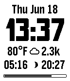
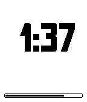
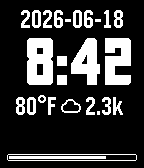
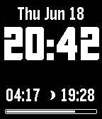

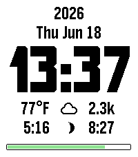
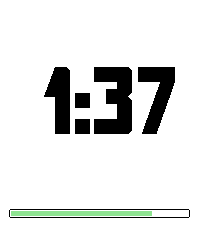
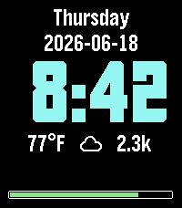
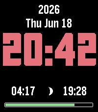
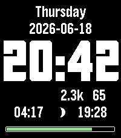

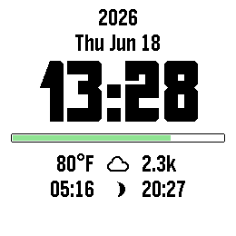
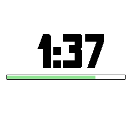
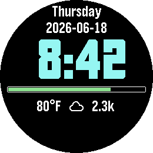
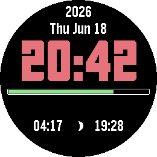
